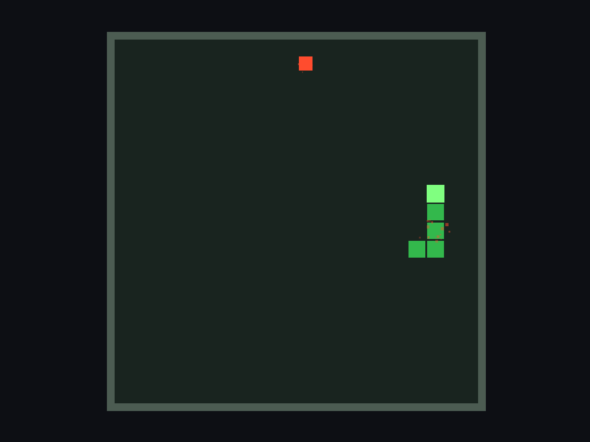
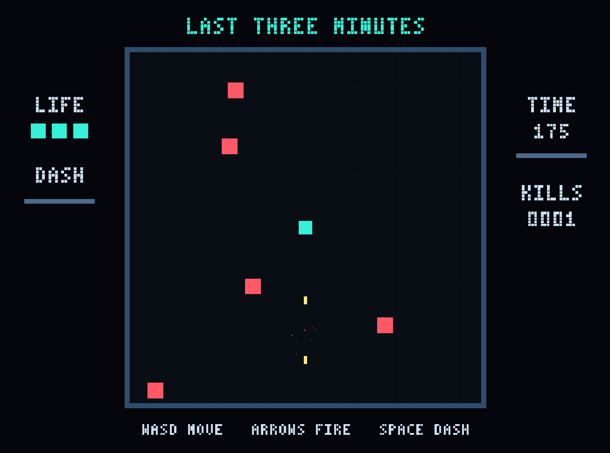

<div align=center>
    <h1 align="center">Vulcal Engine</h1>
</div>
<div align=center>

<a href="https://github.com/Virtual-Graphics/VulcalEngine/actions/workflows/ci-windows.yml?query=branch%3Amain"></a>
<a href="https://github.com/Virtual-Graphics/VulcalEngine/actions/workflows/ci-linux.yml?query=branch%3Amain"></a>

<a href="https://github.com/orgs/Virtual-Graphics/projects/1"> 路线图 </a> |
<a href="https://virtual-graphics.github.io/VulcalEngine-website/"> 文档 </a> 


</div>


## INTRODUCTION
Vulcal Engine 是一个架构清晰、代码极简、无 AI Slop、非 Vibe Coding 、轻量、高性能以 ECS 架构为核心、目前使用 OpenGL 4.6 (未来明确支持 Vulkan) 为图形 API 、支持 Lua 脚本语言的游戏引擎。

## GOALS
我们最终期望 Vulcal Engine 能够做到
- 跨平台游戏引擎，支持 Windows、Linux、MacOS、Android、Web 发布游戏。
- 更适合个人开发者与 AI 配合的游戏开发工作流
- 支持多渲染管线的渲染器架构，支持实时光线追踪管线，延迟渲染（主要），以及轻量级前向渲染管线。
- 高性能游戏引擎，支持在低端设备上高效运行，包括移动端。
- 可编程渲染管线，暴露低级图形 API 供开发者使用。
- Native C++ 开发模式

## 示例小游戏

<table>
  <thead>
    <tr>
      <th>游戏截图</th>
      <th>项目与说明</th>
    </tr>
  </thead>
  <tbody>
    <tr>
      <td></td>
      <td>
        <p><strong>贪吃蛇</strong></p>
        <p>项目：<a href="projects/snake/snake.vproj"><code>projects/snake/snake.vproj</code></a></p>
         <p>编辑器打开项目并点击 Play，自动开始，WASD 移动，Space 重新开始。</p>
      </td>
    </tr>
    <tr>
      <td></td>
      <td>
        <p><strong>最后三分钟</strong></p>
        <p>项目：<a href="projects/arena/arena.vproj"><code>projects/arena/arena.vproj</code></a></p>
        <p>编辑器打开项目并点击 Play，Enter 开始，WASD 移动，方向键射击，空格冲刺。</p>
        <p>规则与测试见 <a href="projects/arena/README.md">项目说明</a>。</p>
      </td>
    </tr>
  </tbody>
</table>

## START
v0.0.5 以源码形式发布，不包含预编译可执行文件。下载并解压源码包后，在源码根目录执行以下步骤即可构建，无需 Git 仓库历史。

构建需要 Git、CMake ≥ `3.28`，以及支持 C++23 的编译器。第三方依赖会在配置阶段自动下载，首次配置需要联网；源码包不包含下载后的第三方依赖。运行编辑器、模型查看器和图形测试还需要支持 OpenGL 4.6 的显卡驱动。

### Linux

Ubuntu / Debian 系统可以参考以下命令安装系统依赖；安装后仍需确认 CMake 与编译器满足上述版本要求：

```bash
sudo apt-get update
sudo apt-get install -y \
    git build-essential cmake ninja-build pkg-config \
    libasound2-dev libdrm-dev libegl1-mesa-dev libgbm-dev \
    libgl1-mesa-dev libgtk-3-dev libudev-dev libwayland-dev \
    libx11-dev libxext-dev libxrandr-dev libxcursor-dev libxi-dev \
    libxinerama-dev libxkbcommon-dev wayland-protocols
```

构建、测试与运行：

```bash
cmake -S . -B build -G Ninja -DCMAKE_BUILD_TYPE=Debug
cmake --build build --parallel
ctest --test-dir build --output-on-failure

./build/bin/editor                    # 编辑器，可打开 projects/ 下的 .vproj
./build/bin/model_viewer model.obj    # 查看 OBJ 模型
```

### Windows

安装 Git、CMake 和支持 C++23 的 Visual Studio C++ 工具链，然后在 PowerShell 中执行：

```powershell
cmake -S . -B build -A x64
cmake --build build --config Debug --parallel
ctest --test-dir build -C Debug --output-on-failure

.\build\bin\Debug\editor.exe
.\build\bin\Debug\model_viewer.exe model.obj
```

也可以使用 `CMakePresets.json` 中的预设；其中 `msvc` 预设要求 Visual Studio 2026，`clang-debug` 预设使用 PATH 中的 `clang-cl` 和 Ninja。

### 着色器与图形测试

引擎内置着色器在构建时自动嵌入程序，运行时不需要源码目录或外部 GLSL 文件。修改 `vulcal_engine/render/shaders/` 下的着色器后，重新执行构建即可更新。

默认测试不需要图形显示环境。要启用需要 OpenGL 4.6 的图形测试，在配置时增加 `-DBUILD_GRAPHICS_TESTS=ON`，重新构建后运行测试；Windows 多配置构建的测试命令仍需添加 `-C Debug`。启用图形测试后，需要可用的图形显示环境。

如果你依然构建失败，可以将如下 Prompt 发送给你的 Agent
```
帮我在电脑本地成功构建 https://github.com/Virtual-Graphics/VulcalEngine 这个项目
```


## PRINCIPLE
在 AI 时代下，稍微了解一些游戏引擎的程序员都能借助 Agents 开发游戏引擎，互联网上也出现各种所谓的 “自研引擎” 的演示视频，Vulcal Engine 的开发者也是 AI Coding 的重度依赖者，前前后后在 AI 的帮助下开发了 6 个游戏引擎了（不包括此引擎）。无论是作者自己用 AI Coding 的引擎，还是其他人用 AI Coding 出来的引擎，如果没有使用一种合理的开发流程那么最后都会沦落为和作者前 6 个引擎一样的下落逐渐被抛弃（原因是因为在有了 AI 的加持下，我天然的认为自己什么软件都能写出来了，但事实上相反的，我如果借助 AI 开发了我自己理解不了的代码（最终也许能实现出来，但也只能是个玩具），那么项目就会逐渐变得不可维护，而我脑海中存在各种奇思妙想的游戏引擎架构，我没有具体的架构方案（通常他们很复杂））。


当然如果其他开发者没有和我一样的 审美/代码品味/产品品味 他们也许不会抛弃，但结果就是代码成为屎山，软件不可维护。我们需要 [正确使用 AI Coding](https://blog.cglab.top/posts/new/2026-10-25-correct_for_ai_coding/) 。但据我所知大多数其他人的引擎最后都没有继续维护下去，因为他们意识到他们的软件已经变成了屎山，变得不可维护。所以我们不要 Vibe Coding 这只会浪费你的时间，浪费你的 token。

除此之外，程序员们在写一个软件的时候通常不会预先知道他们要开发的软件的全部细节、技术栈、架构等等。我们希望在开发的过程中学习到自己还不会的东西，但使用 Vibe Coding 你只能学会与 AI 扯皮，除此之外几乎什么都学不到。

所以 Vulcal Engine 采用的大致工作流是（不固定）:
1. 开发者调研方案 
2. 与 AI 或者 其他开发者讨论方案，直到确认方案是适合的
3. 使用 Agent Plan Mode 让其给出大知道的代码，开发者进行第一步审查
4. 确认没问题后，Agent 开始修改代码。
5. 开发者对代码进行第 2 次审查
6. 如果没问题合并代码，如果有问题则配合 AI 或其他开发者讨论并回到第 3 步

我知道这种模式非常的低效，完全匹配不了 AI 的编码速度，但只有这样 **我** 才能写出我满意的程序，我们需要工匠精神。

我们需要明确高度约束的是代码质量，系统一致性，架构一致性，如果当代码变得 人类无法维护 则说明已经被 AI 写烂了需要回退代码重构。哈嗯，你也想被 AI 一次 commit `100'000` 行代码，一天上千次 commit 的 AI Slop 淹没吗？


## OTHER
现在初步基本由我一个人完成对 VulcalEngine 的全部工作，并且不支持任何人添加 Pull Request ，如果你想指出一些问题应该直接联系作者，至于联系方式嘛，既然你都能看到这个仓库了，还会没有作者的联系方式？作者将会在业余时间开发，哈哈，其实作者更本没有工作，大三在读学生，应该说作者所有的时间都是业余时间，但是作者除了 VulcalEngine 要开发外，还有更多的其他的事情要做，作者只会在觉得这个时间段是开发 VulcalEngine 合适的时间段进行开发。

## ABOUT
采用 MIT 开源证书，本引擎能随意修改并作为商用，并且引擎开发的游戏也能随意商用，提供最高的自由度。

